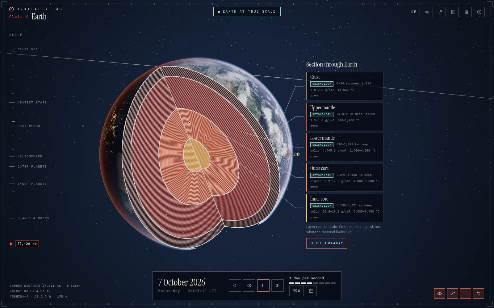
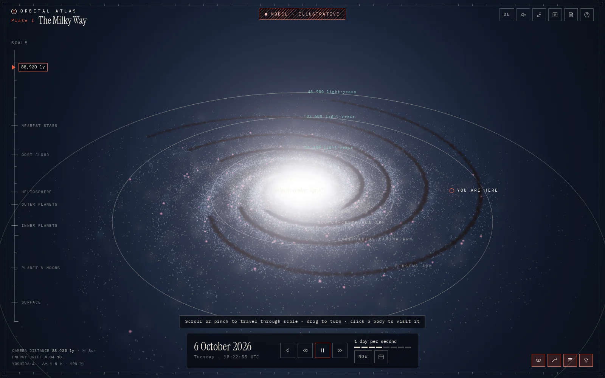
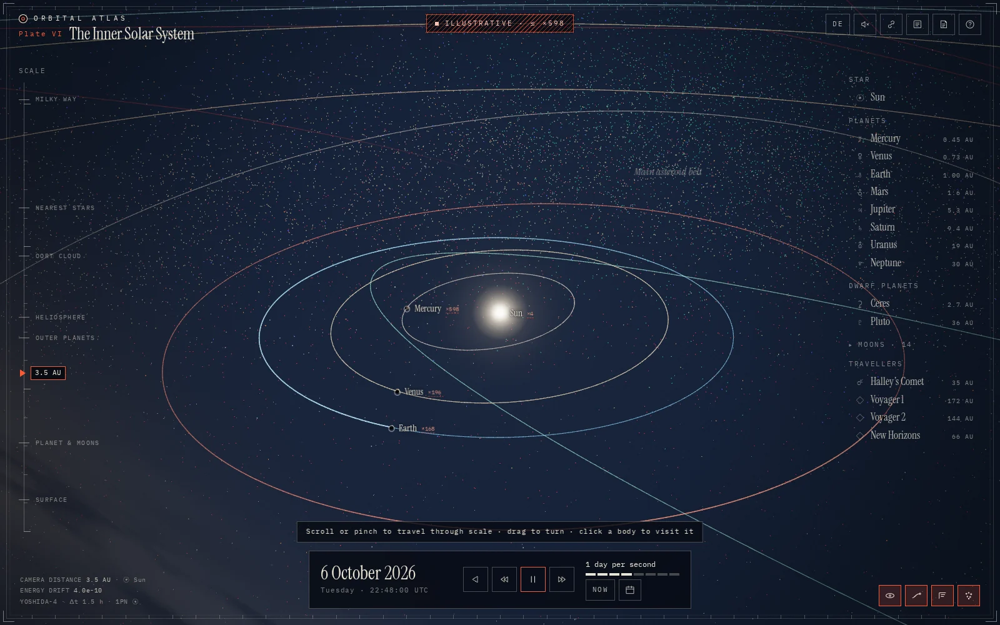
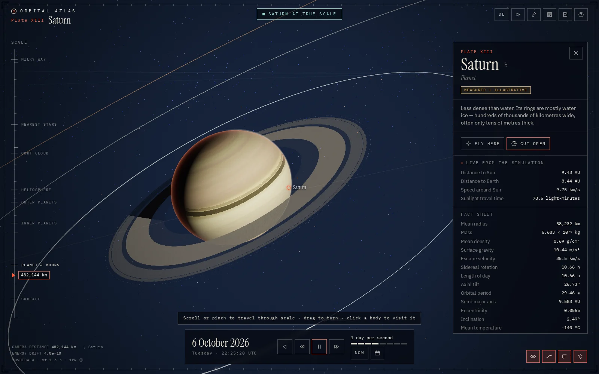
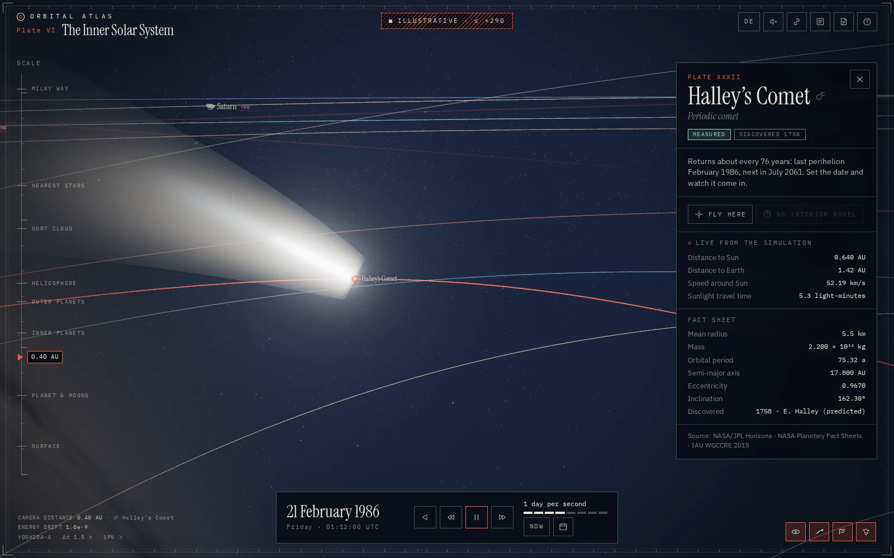

# Orbital Atlas

**An atlas of the solar system — computed, not drawn.**

Orbital Atlas is an interactive 3D explorer that runs in the browser. It zooms through sixteen orders of magnitude, from the whole Milky Way down to a few thousand kilometres above a moon, and opens planets up into labelled, to-scale cross-sections. Every position on screen comes out of a Newtonian N-body integration that starts from NASA/JPL state vectors.

**Live:** [kaufmeinewebsite.de/orbital-atlas](https://kaufmeinewebsite.de/orbital-atlas/) · German and English · desktop and mobile



| | |
|---|---|
|  |  |
|  |  |

## What it does

- **Powers-of-ten zoom.** Scroll from planetary surfaces out past the heliosphere, the Oort cloud and 37 nearby stars to the Milky Way. Far out, the camera's reference frame turns from the ecliptic to the galactic plane.
- **Real orbits.** The Sun, the planets (as system barycentres), Earth, the Moon, Ceres, comet Halley and Voyager 1, Voyager 2 and New Horizons are integrated together. Thirteen major moons follow Kepler orbits from JPL elements, nearly 25,000 real asteroids, trojans, centaurs and Kuiper-belt objects follow Kepler orbits computed on the GPU.
- **Time controls.** Play, pause, reverse, eight speeds from real time to ten years per second, "now", and a date picker for 1800–2199. Jumping to 1986 integrates forty years backwards in about a second.
- **Cutaways.** Thirteen bodies open into to-scale sections. Each layer is engraved by state of matter (hatching = solid, flowing rings = liquid, stipple = gas …) and labelled with depth, density, temperature, references and *how* we know it: seismology, gravity and rotation, or model.
- **True scale vs. illustrative.** A badge at the top always states what is drawn. In illustrative mode bodies are enlarged only until they are a few pixels wide, and every enlarged label carries its factor (`×780`). Zooming in never makes anything shrink, and the badge switches to "Earth at true scale" once the planet in focus is drawn 1 : 1. The Milky Way and the Oort cloud are marked as models.
- **Honest maps.** Surfaces are mission imagery. Where a world was never photographed (Pluto's and Charon's southern hemispheres), the map stays blank and is hatched as *terra incognita*.
- **Atlas details.** Plate numbers, a scale altimeter, live distances and light travel times, a fact sheet per body, astronomical symbols, a legend, a colophon with every source, deep links (`?body=saturn&date=1986-02-20&lang=de`), keyboard shortcuts and generative sound that darkens as you zoom out.

## How accurate is it?

The integrator is checked against JPL's DE441 ephemeris on every test run. Distance between computed and JPL positions:

| Body | −10 years | +10 years | +50 years |
|---|---:|---:|---:|
| Earth | 2.8 km | 1.4 km | 11 km |
| Venus | 0.7 km | 0.5 km | 5 km |
| Mercury | 5.1 km | 4.4 km | 18 km |
| Mars | 3.8 km | 3.3 km | 12 km |
| Jupiter | 7.7 km | 7.0 km | 35 km |
| Saturn | 2.0 km | 3.1 km | 27 km |
| Neptune | 7.2 km | 7.3 km | 226 km |
| Moon | 178 km | 188 km | 907 km |

Relative energy drift stays around 10⁻⁹ over a century. What is *not* modelled: asteroid perturbations beyond Ceres, planetary oblateness and tides (why the Moon is the least accurate), and comet outgassing.

## How it is computed

- **Initial conditions:** barycentric state vectors (ecliptic J2000, TDB) for 1 January 2026 from the [NASA/JPL Horizons API](https://ssd.jpl.nasa.gov/horizons/), ephemeris DE441. GM values from DE440 (Park et al. 2021).
- **Integrator:** fourth-order symplectic composition of leapfrog (Yoshida 1990), fixed step of 1.5 hours, so energy errors stay bounded and the simulation runs backwards as well as forwards. It includes the first post-Newtonian correction for the Sun, evaluated at the mid-kick velocity to keep the scheme symmetric. Without it Mercury drifts by 1,700 km in ten years; with it, by 4 km.
- **Display between steps:** a partial step from a copy of the state, so the picture is smooth at any speed without disturbing the integration.
- **Rotation:** poles and prime meridians from the IAU WGCCRE 2015 report, so Earth's day/night line and Jupiter's System III rotation are where they should be for the displayed date.
- **Rendering:** three.js with camera-relative float64 positions and a logarithmic depth buffer, so a moon 1,000 km away and a galaxy 100,000 light-years away can share one frame. Planets use custom shaders: city lights, cloud shadows, ocean glints, atmospheric rims, ring shadows, planet shadows on rings and a granulating Sun.

## Data and imagery

All fetched by scripts in `scripts/`, so every number is reproducible.

| Data | Source |
|---|---|
| State vectors, moon elements, spacecraft trajectories | NASA/JPL Horizons |
| Asteroids, trojans, centaurs, TNOs | NASA/JPL Small-Body Database |
| Sky | Yale Bright Star Catalogue, 5th ed., via VizieR (CDS) |
| Nearest stars | SIMBAD (CDS, Strasbourg) |
| Earth, clouds, night lights | NASA Earth Observatory (Blue Marble NG, Earth at Night) |
| Moon | NASA SVS CGI Moon Kit (LRO LROC) |
| Mars, Mercury, Pluto, Charon | USGS Astrogeology (Viking, MESSENGER, New Horizons mosaics) |
| Jupiter | NASA/JPL/SSI, Cassini PIA07782 |
| Saturn, Uranus, Neptune | Hubble OPAL programme (latitude colour profiles), true-colour balance after Irwin et al. 2024 |
| Interiors | PREM, Apollo, GRAIL, InSight, MESSENGER, Juno, Cassini ring seismology, Galileo, New Horizons — full list in the in-app colophon |

The galaxy is a model built from measured parameters (Bland-Hawthorn & Gerhard 2016; Bennett & Bovy 2019; Vallée 2017). Arm positions far from the Sun are uncertain, and the plate says so.

## Run it

```bash
npm install
npm run dev        # http://127.0.0.1:5190/orbital-atlas/
npm test           # physics against DE441, i18n parity, interior models
npm run build      # static site in dist/, served under /orbital-atlas/
```

Refresh the data (optional; results are committed):

```bash
npm run daten:horizons   # state vectors, validation dates, moon elements
npm run daten:sterne     # Bright Star Catalogue + SIMBAD
node scripts/fetch-small-bodies.mjs
node scripts/fetch-trajectories.mjs
npm run daten:texturen   # needs the raw mission maps in quellen/roh/ (~2 GB)
```

Browser probe (headless Chromium, software WebGL, screenshots in `pruef-ausgabe/`):

```bash
node scripts/pruef/schau.mjs --small --tour=skip --tour=jump:saturn --tour=cut:saturn
```

## Project layout

```
src/
  physics/   N-body integrator, Kepler solver, IAU rotation, reference frames
  data/      bodies, interiors, rings, galaxy parameters, sources (+ generated/ from the scripts)
  render/    engine, camera, planets & cutaways, orbits & trails, sky/galaxy/small bodies, shaders
  ui/        atlas interface: plates, altimeter, time console, index, plate card, cutaway labels
  i18n/      English and German
  audio/     generative sound (Web Audio, no files)
scripts/     data fetchers, texture pipeline, browser probes
tests/       physics validation against DE441, i18n, interiors
```

No framework: TypeScript, three.js, Vite. Fonts are self-hosted, and the page makes no third-party requests and sets no cookies.

## Credits and licence

Code: MIT, © 2026 Darius Hofman. Imagery and data remain under the terms of their providers (NASA and USGS imagery is public domain; the Hubble OPAL acknowledgement and the SIMBAD notice are reproduced in the colophon).

Built with an AI coding assistant.
